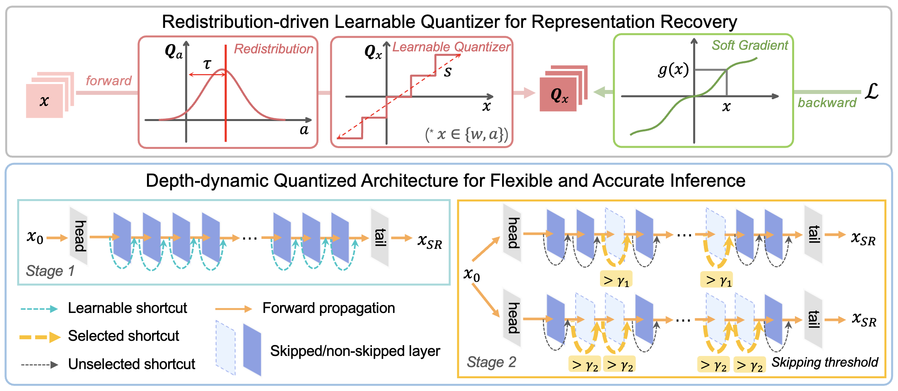

# QuantSR: Accurate Low-bit Quantization for Efficient Image Super-Resolution

**NeurIPS 2023 · Spotlight**

Haotong Qin, Yulun Zhang, Yifu Ding, Yifan Liu, Xianglong Liu, Martin Danelljan, Fisher Yu

[Published paper](https://proceedings.neurips.cc/paper_files/paper/2023/hash/b2169d573d75ff90c7b12dc3a5fc2898-Abstract.html) | [OpenReview](https://openreview.net/forum?id=3gamyee9Yh) | [Citation](#citation)

**QuantSR performs accurate 2–4-bit image super-resolution through a Redistribution-driven Learnable Quantizer (RLQ) and a Depth-dynamic Quantized Architecture (DQA).** It combines information retention in quantized operators with shared-weight depth choices for an accuracy/efficiency trade-off.

## Published results

Selected ×4 results from Table 2. PSNR (dB) is higher-is-better; W/A denotes weight/activation bits in the quantized body. QuantSR-C uses SRResNet; QuantSR-T uses SwinIR-S. Training and evaluation follow Sections 3.4 and 4.1.

| Backbone / method | W/A | Set5 PSNR | Urban100 PSNR |
| --- | --- | --- | --- |
| SRResNet / full precision | 32/32 | 32.16 | 26.11 |
| SRResNet / PAMS | 4/4 | 31.59 | 25.32 |
| SRResNet / QuantSR-C | 4/4 | 32.00 | 25.88 |
| SRResNet / PAMS | 2/2 | 29.20 | 23.58 |
| SRResNet / QuantSR-C | 2/2 | 31.30 | 25.13 |
| SwinIR-S / full precision | 32/32 | 32.44 | 26.47 |
| SwinIR-S / QuantSR-T | 4/4 | 32.18 | 26.11 |
| SwinIR-S / QuantSR-T | 2/2 | 31.53 | 25.26 |

These are published reconstruction scores, not new runs. The paper's Params/Ops reductions (Table 3) use bit-width-aware theoretical accounting and depth choices; they do not establish equal reductions in GPU latency or runtime memory. Head/tail layers are retained at full precision in the reference protocol.

### What this paper supports

- RLQ mitigates quantization-induced representation homogeneity using redistribution in forward and backward propagation (Section 3.2; Table 1).
- DQA supports inference at multiple depths with shared weights (Section 3.3; Figure 4).
- For SRResNet at ×4 and W2A2, QuantSR-C improves Set5 PSNR by 2.10 dB over PAMS (Table 2).
- The approach works on the evaluated convolutional and Transformer SR backbones, with remaining full-precision gaps shown above (Section 4.3; Table 2).
- Bit-width and depth jointly control theoretical storage/computation and reconstruction quality (Table 3).



## Dependencies

```bash
# Go to the default directory
pip install -r requirements.txt
python setup.py develop
```

## Execution

```bash
# We provide script to test our 4-bit QuantSR-C
sh test.sh
```

## Citation

Please cite the published paper below. Open paper versions are linked at the top of this README.

```bibtex
@inproceedings{qin2023quantsr,
  title = {{QuantSR}: Accurate Low-bit Quantization for Efficient Image Super-Resolution},
  author = {Haotong Qin and Yulun Zhang and Yifu Ding and Yifan Liu and Xianglong Liu and Martin Danelljan and Fisher Yu},
  booktitle = {Advances in Neural Information Processing Systems},
  year = {2023},
  volume = {36},
  url = {https://proceedings.neurips.cc/paper_files/paper/2023/hash/b2169d573d75ff90c7b12dc3a5fc2898-Abstract.html}
}
```
